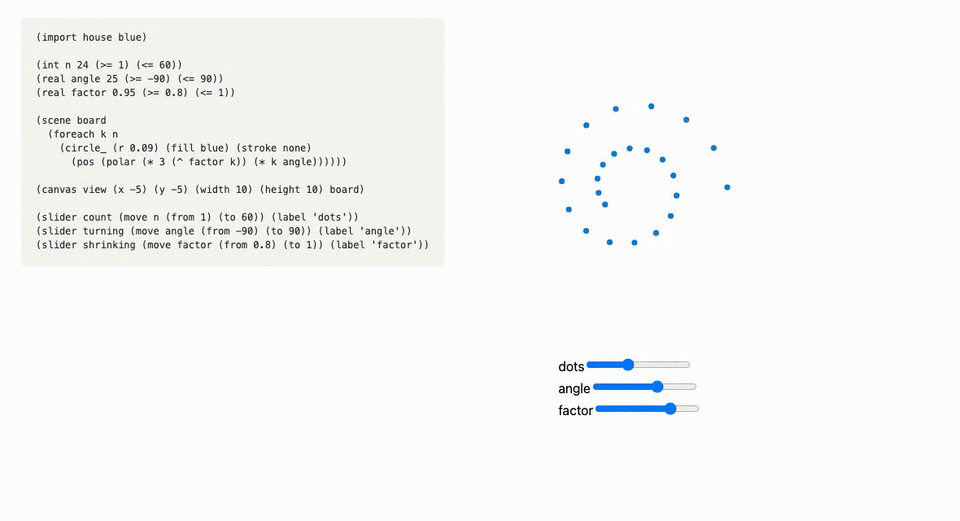

# Mathterpiece

Mathterpiece (mtp) is a small language for math figures that readers can drag, slide and play.
You describe a figure in a `.mtp` file, in a Lisp-like syntax: its variables and their ranges, its
shapes, and how each one depends on the others. The compiler checks it and writes a `.mtpc` file,
which a JavaScript runtime draws on any web page.



The compiler checks the types and the ranges. A figure that could draw something undefined, such
as a circle with a negative radius, does not compile.

## Why a language

- Every figure gets touch, keyboard use, light and dark mode, reduced motion, and labels for
  screen readers, so you do not build them again for each figure.
- Every figure uses the same sliders, buttons and gestures, so readers learn them once. A page
  can restyle them with CSS.
- The source of a figure is a few dozen lines with the mathematics in them, short enough to
  review and to compare between versions.
- A figure is saved as data (the `.mtpc` file), separate from the runtime that draws it. When the
  runtime improves, every published figure gets the improvement, and the file keeps working when
  browsers change.

## Install

You need Python 3.13 or later with [uv](https://docs.astral.sh/uv/), and, for the web runtime,
Node with [pnpm](https://pnpm.io/). [just](https://just.systems/) runs the common tasks.

```sh
uv sync
cd web && pnpm install
```

## Try the examples

```sh
just web-dev
```

This builds every example in `examples/` and serves a page that draws any of them. Vite prints
the address to open.

## Build a world model

```sh
uv run mtp build dial.mtp              # writes build_dial/: the .mtpc and the inventory page
uv run mtp serve dial.mtp              # serves that page, building again on each save
uv run mtp compile dial.mtp            # writes dial.mtpc next to it
uv run mtp compile dial.mtp -o out.mtpc
uv run mtp check dial.mtp              # reports the first error, writes nothing
uv run mtp parse dial.mtp              # prints the forms the parser reads
uv run mtp fmt dial.mtp                # indents the file as the Emacs mode does
```

`mtp build` also writes an inventory page that shows every component of the figure live, next to
the line of HTML that places it on a page. `mtp build` and `mtp serve` need Node and pnpm, because
they build the runtime too.

## Put a live figure on a page

Build the runtime with `just build-web`, which writes `web/dist/mathterpiece.js`. A page loads
it and places the world model's components anywhere in its text. The inventory page `mtp build`
writes lists every component with the line that places it:

```html
<script type="module" src="mathterpiece.js"></script>

<mtp-model id="dial" src="dial.mtpc"></mtp-model>
<p>Drag the slider <mtp-slider model="dial" name="radius"></mtp-slider>
   and watch the <mtp-readout model="dial" name="area"></mtp-readout>.</p>
<mtp-canvas model="dial" name="v"></mtp-canvas>
```

`<mtp-model>` can also read the compiled model from a JSON block anywhere in the page, as in
`<mtp-model id="dial" src="#dial-data">` with `<script type="application/json" id="dial-data">`,
so the page needs no second file. The same lines work in a Markdown file. The data model
("On the page") describes the page's elements, how the author writes them in Markdown, and how a
page restyles a world model's components with CSS.

## Develop

```sh
just web-dev     # build the examples and serve a page that shows any of them
just test        # the compiler's tests
just web-test    # the runtime's tests
just check       # lint, type checks and both test suites
```

## Layout

- `mathterpiece/`: the compiler (`parse.py`, `compiler.py`, `mtpc.py`) and the `mtp` command.
- `web/src/`: the runtime, which plays a `.mtpc` and defines the page's elements.
- `docs/`: the language and the file format, and `docs/figure-guidelines.md`, the rules every
  figure here follows (phones and touch first).
- `examples/`: one figure per feature to read and try, plus the interactive figures from the
  Bourgain notes (`bourgain-*.mtp`). `house.mtp` is not a figure: it holds the colors and fonts that
  the other examples import.
- `tests/`: the compiler's tests; `tests/shared/` holds cases both the compiler and the runtime
  check.
- `web/test/`: the runtime's tests.
- `editors/mtp-mode.el`: an Emacs mode for `.mtp` files.

## Docs

- [Syntax](docs/syntax.md): how a file is written.
- [Reference](docs/reference.md): every form, function and constant.
- [Type system](docs/type-system.md): types, ranges and none.
- [Data model](docs/data-model.md): variables, attributes, who may write them, and the page.
- [The .mtpc format](docs/mtpc.md), with its [JSON schema](docs/mtpc.schema.json).

## License

MIT. See [LICENSE](LICENSE).
