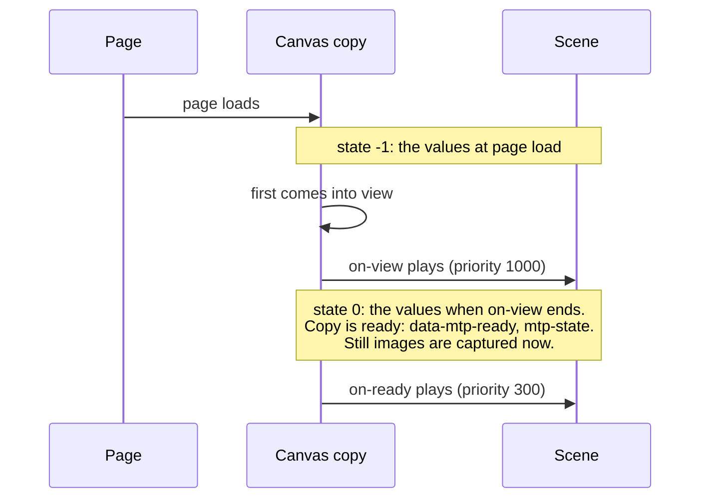

# Lifecycle of a canvas

Status: decided by the author, 2026-11-13 (rest renamed ready, and made a moment, later the same day). Not built yet. It covers a canvas (and a display or
a readout) and its own listeners `on-view` and `on-ready`. No control is involved.

## Timeline

A canvas with no `on-view` has no state -1: the values at page load are its state 0, it is
ready from the start, and its `on-ready` is triggered when the page loads.

## Rules

1. **State -1** of a canvas copy is the values at page load. It exists only when the canvas has
   an `on-view`.
2. **`on-view`** is triggered when the copy first comes into view, if the scene still has the
   values at page load. Otherwise it is not triggered. It may not loop (compile error).
3. **State 0** is exactly the values after the `on-view` has played from the values at page load.
4. **Ready:** a canvas is ready, in every copy at once, from the first moment the `on-view` of one
   of its copies has ended, or from page load if it has no `on-view`. It stays ready from then
   on. Ready is a moment, not a comparison of values. A copy whose `on-view` is not triggered,
   because its values had already changed, is ready because its canvas is.
5. **`on-view`** has priority 1000. Until a canvas is ready, every input that belongs to it is
   disabled, and it is enabled once the canvas is ready. An input belongs to a canvas when it is
   a listener inside the canvas's body, or a control that writes a value some shape the canvas
   shows depends on (the compiler works this out).
6. **`on-ready`** is triggered once, when the canvas becomes ready. It may play any animation, at
   priority 300.
7. **Compile errors:** an `on-view` that loops, and a move in `on-view` whose `to` expression depends on the
   value it moves.
8. **Still images** are captured at the moment a canvas becomes ready.
9. **The page is ready** once every canvas, display and readout on it is ready. Controls do not
   count. A display or a readout has no `on-view`, so it is ready from the start. The page is
   static: no view or control is added to or removed from it after it loads.
10. **On the page** (docs/page-interface.md): each copy has `data-mtp-ready` once ready and
   fires `mtp-state` then. `<mtp-model>` has `data-mtp-ready` once the page is ready. The
   model's old `mtp-ready` event (the model has loaded) is renamed `mtp-loaded`.
11. **`on-show` and `on-hide`** are not part of the lifecycle (the author, 2026-11-14): nothing but
   the `on-view` plays before state 0, ready never waits for them, and they play only when a copy
   starts or stops showing a shape after state 0.
