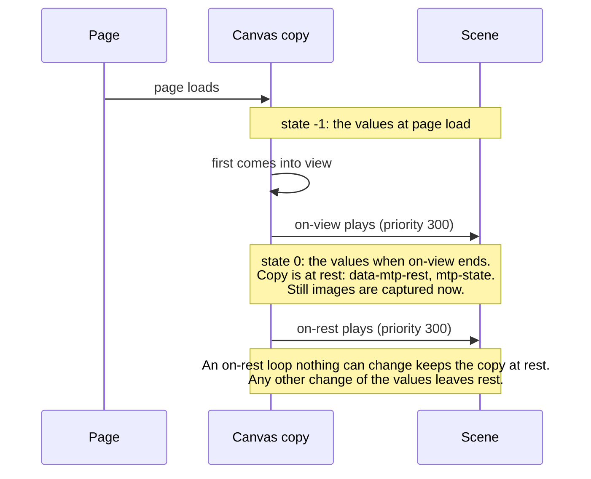

# Lifecycle of a canvas

Status: decided by the author, 2026-11-13. Not built yet. It covers a canvas (and a display or
a readout) and its own listeners `on-view` and `on-rest`. No control is involved.

## Timeline

A canvas with no `on-view` has no state -1: the values at page load are its state 0, it is at
rest from the start, and its `on-rest` is triggered when the page loads.

## Rules

1. **State -1** of a canvas copy is the values at page load. It exists only when the canvas has
   an `on-view`.
2. **`on-view`** is triggered when the copy first comes into view, if the scene still has the
   values at page load. Otherwise it is not triggered. It may not loop (compile error).
3. **State 0** is exactly the values after the `on-view` has played from the values at page load.
4. **At rest:** a copy is at rest while the scene equals its state 0, with the matching rules for
   steps (reals within a small relative tolerance, and so on). Values moved by an `on-rest` loop
   that nothing can change are left out of the match.
5. **`on-rest`** is triggered when the copy first reaches rest. It may play any animation, at
   priority 300.
   - A non-looping `on-rest` is an ordinary writer: the copy leaves rest when it changes values.
   - A looping `on-rest` counts as rest when nothing can change it: no writer that can run while
     the loop runs writes a value it moves, and its `from`, `to`, `duration` and `ease` read no
     value such a writer writes. The canvas's own `on-view` has always ended by then, so it does
     not count. A loop that something can change is a compile error.
   - It is not triggered in a copy when its effect is already running from another copy of the
     same canvas.
6. **Compile errors** wherever state 0 cannot be worked out: an `on-view` that loops, a move in
   `on-view` or `on-rest` whose `to` reads the value it moves, and an `on-rest` loop that
   something can change.
7. **Still images** are captured at the moment a copy first reaches rest.
8. **The page is at rest** while every canvas, display and readout copy on it is at rest.
   Controls do not count. A display or a readout has no `on-view`, so it is at rest from the
   start.
9. **On the page** (docs/page-interface.md): each copy has `data-mtp-rest` while at rest and
   fires `mtp-state` when it changes; `<mtp-model>` has `data-mtp-rest` while the page is at
   rest.
