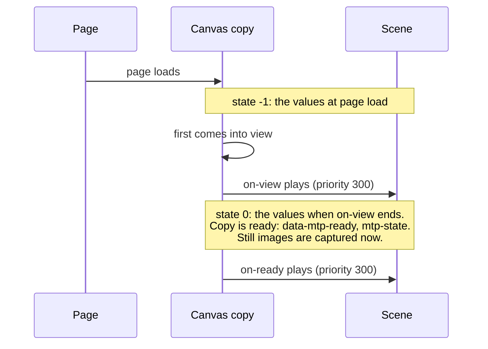

# Lifecycle of a canvas

Status: decided by the author, 2026-11-13 (rest renamed ready, and made a moment, later the same day). Not built yet. It covers a canvas (and a display or
a readout) and its own listeners `on-view` and `on-ready`. No control is involved.

## Timeline

A canvas with no `on-view` has no state -1: the values at page load are its state 0, it is
ready from the start, and its `on-ready` is triggered when the page loads.

## Rules

1. **State -1** of a canvas copy is the values at page load. It exists only when the canvas has
   an `on-view`.
2. **`on-view`** is triggered when the copy first comes into view, if the scene still has the
   values at page load. Otherwise it is not triggered. It may not loop (compile error).
3. **State 0** is exactly the values after the `on-view` has played from the values at page load.
4. **Ready:** a copy is ready at the moment nothing stands between it and the reader's input:
   when its `on-view` ends, or at page load if it has none. It stays ready from then on. Ready is
   a moment, not a comparison of values: nothing the reader or any writer does later changes it.
5. **`on-ready`** is triggered when the copy becomes ready. It may play any animation, at
   priority 300. It is not triggered in a copy when its effect is already running from another
   copy of the same canvas.
6. **Compile errors:** an `on-view` that loops, and a move in `on-view` whose `to` reads the
   value it moves.
7. **Still images** are captured at the moment a copy becomes ready.
8. **The page is ready** once every canvas, display and readout copy on it is ready. Controls
   do not count. A display or a readout has no `on-view`, so it is ready from the start.
9. **On the page** (docs/page-interface.md): each copy has `data-mtp-ready` once ready and
   fires `mtp-state` then. `<mtp-model>` has `data-mtp-ready` once the page is ready. The
   model's old `mtp-ready` event (the model has loaded) is renamed `mtp-loaded`.
