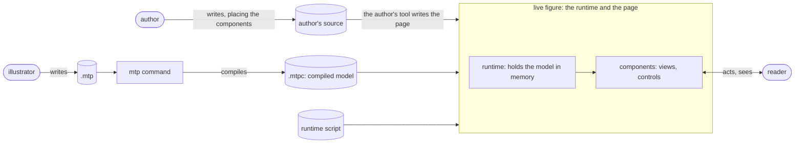
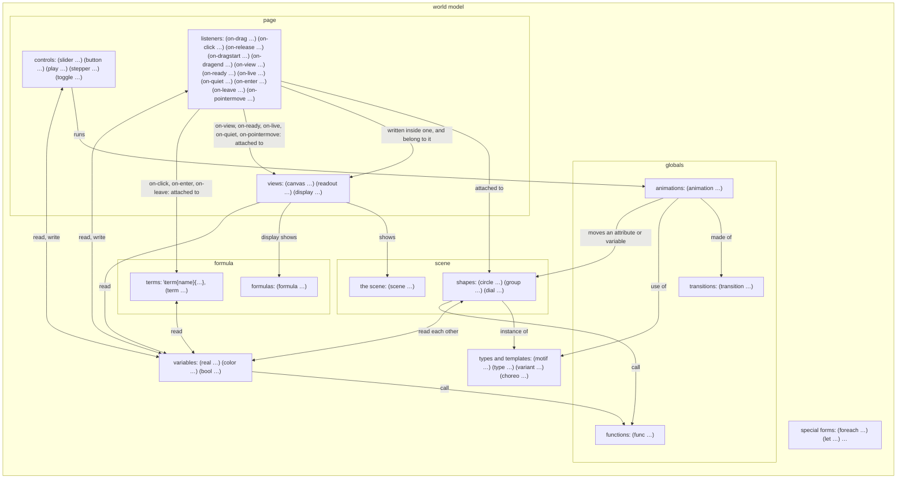

# The data model

Who is involved, how a source file becomes something a reader can use, and what the world model holds.

## Three people, one command, five artifacts

Three people take part, each with a job of their own. The **illustrator** writes a world model as an `.mtp` source file, and the **mtp command** compiles it into the **.mtpc**, the static model. The **author** writes the source of a paper, a web page, and places the world model's components in it alongside the rest of its content. The **reader** opens the page and uses the **live figure**: the runtime and the page together, which hold the live model. The .mtpc is the only thing that passes from the illustrator's side to the author's and the reader's.

The five artifacts:

| Artifact | Who makes it | What it is |
|---|---|---|
| **the `.mtp`** | the illustrator | the world model's source |
| **the `.mtpc`** | the mtp command | the compiled model, also called the static model |
| **the runtime script**, `mathterpiece.js` | mtp itself, the same for every world model | the library that turns a compiled model into a live one and defines the page's elements |
| **the author's source** | the author, in a tool of their own, such as a Markdown file | the paper, with the elements that place the components (see "Pages the author writes in Markdown") |
| **the live figure** | the reader's browser, from the page the author's tool writes | the runtime and the page together, holding the live model |

The two jobs may fall to one person, as when a researcher writes the world models of their own paper, or to two, as when a paper uses a world model someone else wrote. The inventory page `mtp build` writes is outside this picture. The illustrator uses it to see the live figure while they work, and the author uses it to learn which components a world model has and how to place each one.

### The illustrator

Writes a world model as a `.mtp` source file: the shapes, the values they depend on, how they can move, and how a reader can act on them. The illustrator thinks about mathematics and how to show it, not about programming, so the language says what things are and leaves keeping them current to the software. The illustrator works only on the world models; the author decides where their components go.

### The author

Writes the paper, a web page, and places components of the world models in it alongside the rest of the scientific content: a drawing here, a slider there, a number inside a sentence (see "On the page"). The author styles them with the page's own CSS, and may restyle a world model's tokens through their CSS variables.

### The mtp command

Runs on the illustrator's machine. **Building** an `.mtp` is four steps, and each has its own name; "compile" and "build" are not interchangeable:

1. **Parsing.** The **parser** reads the text into forms and knows only the syntax.
2. **Compiling.** The **compiler** resolves every name, checks every type, works out everything that can be known in advance, and makes the model, in memory.
3. **Writing the .mtpc.** The **writer** saves the model as the .mtpc.
4. **Writing the inventory page.** It also writes a web page that holds the runtime and the compiled model and lists what an author needs: the lines that load the runtime and the compiled model, in both of the ways `<mtp-model>` takes it; every component in the order the source declares it, live, with its name and the line of HTML that places it, ready to copy; every listener, with what it does; and every token, with its CSS variable and a control that restyles the components on the page. The illustrator sees the live figure at once instead of a long file of JSON, and the author sees what there is to place. With `?record` at the end of its address, it shows instead the figure alone on a 9:16 page, for recording a short (reference, "Recording mode").

Compiling should be fast, but the reader comes first: anything that can be decided here is, even when it makes compiling slower.

The command's subcommands each take one source file, and each runs the steps up to a point:

| Command | Steps | What it does |
|---|---|---|
| `mtp parse file` | 1 | prints the forms the parser reads, one per line, indented by depth |
| `mtp check file` | 1, 2 | reports the first error, if any, and writes nothing |
| `mtp compile file` | 1 to 3 | writes the .mtpc |
| `mtp build file` | 1 to 4 | writes the .mtpc and the inventory page |
| `mtp serve file` | 1 to 4, again on each save | builds, serves the inventory page on the illustrator's machine, and builds again and reloads the page whenever the source file is saved |
| `mtp fmt file` | 1 | rewrites the file in the house layout, keeping its comments |

**What `mtp check` reports.** The first error in the file, with its line and column, and nothing after it: the parser and the compiler stop there. Errors are of two kinds. A **syntax error** comes from parsing: an unclosed parenthesis or string, a name that is not valid, a stray character. A **compile error** comes from compiling: a name that is not declared or is declared twice; a form that is not where it may be or is missing a part; a value of the wrong type; a constraint, or a range a value must stay in, that cannot be proved, such as a radius that might be negative; a value known when compiling that is undefined there, such as `(/ 1 0)`; and anything the reference calls a compile error. Whatever the compiler cannot decide is not an error: a value that may be none while drawing is typed `T|none`, and the illustrator handles it.

### The live figure

What the .mtpc becomes on the author's page: the page and the **runtime**, the library in the runtime script, which the page loads once, together. The runtime rebuilds the model in memory, keeps it current as the reader acts, and serves the **components** the author placed on the page.

### The reader

Opens the page and uses what the author placed there: drags points, moves sliders, presses play, reads values in the prose. The reader never sees the language, and expects every action to show its effect at once. That is the first requirement of everything here: nothing is decided while the reader waits.

**The .mtpc** (mtp compiled) is a JSON file: the model's static representation. Objects have ids, expressions are Lisp-shaped arrays with the operation first, every reference to an object is resolved to an id, and every type the runtime needs is written down. The runtime never reads the source. Its format is specified in `mtpc.md`.

## The language

An `.mtp` file is written in the mtp language. It is Lisp-like: everything is a form in parentheses, with the head first, as in `(circle p (r 0.2))`. It is declarative: the illustrator says what exists and what each thing is equal to, never what to do step by step, and it is reactive: anything given by an expression is bound to it, and follows it for as long as the page is open. When the reader moves a slider, everything that reads what the slider writes changes at once, with nothing written to make that happen.

It is strongly and statically typed: every object's type is known when compiling, and nothing converts silently except a number broadening (an int where a real is expected) and a literal taking the type expected where it is written. Names are bare. Nothing has a side effect except a declaration making its object exist.

Everything in a source file is an **expression**. Some expressions are **forms**: a head and its parts in parentheses. Some forms are **declarations**: their only effect is that a new object exists in the world model, and they return that object, as `(circle p (r 0.2))` returns the circle it declares. Components (views, controls and listeners) are declarations too. **Function calls** have no effect at all and matter only for what they return, as `(+ k 1)` does. A few **special forms** are exceptions, such as `if`, which evaluates only the branch taken, and `let`, which binds names (see the reference, "Special forms"). Type expressions, such as `list[color]` or `(real (>= 0))`, are not evaluated at all: they describe a type.

The whole purpose of an `.mtp` file is to define one **world model** (the **model** for short), as a sequence of declarations.

## The world model

The world model is everything one source file defines. The compiler builds it, the .mtpc stores it, and the runtime holds it live. **Everything in the model is an object, and every object has a type.**

Objects are of two sorts. A **value** is an immutable object: it never changes, and an expression that gives one gives just that value. The number 3 is a value. A **mutable object** can change over time: an attribute of it is written by the reader's actions, or follows an expression that reads something that changed.

A **variable**, such as `(real k 1)`, is not a value: it is a name for a piece of state that holds one object of its type at a time. The objects it holds may be values (3, then 4) or mutable objects (a shape). It evaluates to what it currently holds, and has no attributes of its own.

Every box below has a title and examples of the forms that declare what it holds. Arrows are relations between them. Apart from function calls, forms fall into six groups: special forms, declarations that create types, declarations of things in the scene, declarations of things in a formula, declarations of things on the page, and **globals**: declarations of things in none of them, which all use. A variable belongs to the scene when declared in it, to a formula when declared in one, and to the globals otherwise. Either way, views may read it, and controls and listeners may read it and write it, as long as it is free, has no `const` constraint, and is not a token. A motif's body may declare only bound variables; free per-instance state is a motif parameter. A choreo creates a kind of animation, as a motif creates a kind of shape, but it declares no type: the compiler writes each use of it out as an ordinary animation, so the compiled file holds animations only.

Variables are declared inside the scene (then they belong to it), at the top level (then they are globals), or in a motif's body (then each instance holds them; only bound ones). They are not declared inside groups. The diagram draws them once.

A **namespace**, `(namespace theme (color ink …) (real gap 0.4))`, is a global mutable object that is not drawn: its members are variables and other namespaces, read and written through it as attributes are, `theme.ink` as `c.r` is (see the reference, "Namespaces").

A group (a row and a column included) and a motif instance are both **containers**: collections of shapes, which behave the same way. Neither draws anything itself, so an attribute such as `fill` or `stroke` is never a container's own: reading one gives every member's, and writing one writes every member's. What an instance has besides is a frame of its own, moved by its `x`, `y`, `translate` and `transform`, and its parameters. The reference, "Containers", gives the full rules, `(defaults …)` included.

- **The scene** is the mathematical content: the shapes, and the variables declared with them. It is a subset of the model and knows nothing of how it is shown or changed. The model includes the scene; the scene never includes the rest of the model.
- **A formula** is typeset math, as the scene is geometry: its LaTeX, its **terms**, the pieces of it marked in the LaTeX, which are objects with attributes as shapes are, and the variables declared in it. A display shows it on the page, as a canvas shows the scene, and listeners attach to its terms as they attach to shapes. The scene and a formula never read each other, and neither does one formula another: what they share is a global.
- **Components** are what the illustrator declares and the author places on the page. They come in two sorts, by the direction information flows: **writers** (controls and listeners) carry the reader's actions into the model; **views** carry the model to the reader. ("Reader" on its own always means the person.) Basic components come from the standard library, and authors will be able to make their own from them.
- **Writers are active or not.** A writer that is **active** accepts triggers: a press of a button, a move of a slider's knob, a click on a toggle, a drag, a click on a shape, a release over one, the start or the end of a drag, a canvas coming into view or to rest, a view going live or back to quiet. Once **triggered**, it writes what it targets, directly or through its animation. An inactive writer cannot be triggered, and what it already set off goes on. The illustrator says when a writer is active with `(active bool)`, and a writer without one is always active.
- **Writers belong to views.** Every listener is written inside the body of the view it acts in, and belongs to that view alone: a listener on a shape or a term hears the pointer only there, so a shape that reacts in two canvases has a listener written in each, and each is an object of its own. A control is declared at the top level and may name, with `(in view…)`, the views it belongs to; one that names none belongs to no view.
- **A view may be quiet or live.** A view with an `on-live` has a quiet mode: it starts **quiet**, at rest, as the starting values draw it, and the reader makes it **live** through a hand in its corner, and puts it back through a cross. Going live plays its `on-live`, which takes the figure to its live look, and going back plays its `on-quiet`. The mode is the view's, not the scene's or the world model's, so two canvases of one scene may be one quiet and one live. While a view is quiet, the controls that belong only to quiet views are put away, and the listeners that belong to it hear nothing in it (reference, "Quiet and live views").
- **A writer animates only toward a state it knows.** A triggered writer with an animation builds a path from the state at that moment (or from a transition's own `from`) to the state the animation ends at, then writes along it over the animation's duration. It can do so only if that end state is known when it is triggered. A writer whose end state is never known then, such as a drag, which goes wherever the reader takes the pointer, takes no animation. A writer whose end state is known only sometimes follows its animation whenever the end is known, and otherwise writes the end state at once. (A slider differs: its knob sets how far along its animation things are, not a path played over time; see the reference.)
- **Other ways of showing the model** are possible later: scripts on the page reading the model (see "On the page" and "Open"), descriptions for screen readers, sound, and export to an image or data.

## What changes, and what follows

Every variable, and every attribute of a mutable object, is either **free** or **bound**.

- **Free**: it holds whatever was last written to it, starting with the object its declaration gives (a literal, a constant, a default, or the value of an expression marked `free@`, read once when the live model is built and never followed after: `(real k free@(* 2 a))`). A constant is the bare name of a `const` variable or of a built-in constant such as `pi`, or a read of a `const` attribute such as `c.r`: `(angle golden-angle)` is free, starting at golden-angle's value, as if that value were written. While the reader uses the page, only writers (controls and listeners) and the animations they run may write it. Free ones include a variable given a value, a shape attribute given a value, a motif parameter of an instance, and an attribute a variant leaves unset. A write to a group's attribute (`g.r`) writes each member's. Every random value is bound to a **seed**, a free variable of type `rand-seed`: the live model is the same on every refresh, and writing a new seed, rolling the dice, draws every value that follows it again.
- **Bound**: it is given by any other expression, and always equals that expression. Nothing may write it.
- **A token**, a color or font variable, effectively acts as a bound variable: it is bound to something not declared in the world model, the page's value for its CSS custom property, with its declared value as the fallback (see "On the page"). So it is never known when compiling, and nothing in the figure may write it.

&nbsp;

    (real k 1)                     ; free: a slider may write it
    (circle c (r (* 2 k)))         ; c.r is bound: it is always twice k
    (slider s (move k (from 0) (to 3)))

So every change starts at something free, and spreads to everything bound to it: when the slider writes `k`, `c.r` follows at once, and so does anything that reads `c.r`. The runtime recomputes only what reads what changed. A free variable with the `const` constraint can never be written, so it is known when compiling and costs nothing while drawing.

## How reactivity works

A world model is not a program that runs from top to bottom. It is a set of statements that are true at every moment: `(circle c (r (* 2 k)))` does not set `c.r` once, it says that `c.r` is always twice `k`.

- **Change only enters through writers.** When the reader acts, a control or a listener runs an animation, and the animation writes free variables and attributes over time, frame by frame. A drag writes its target directly, and so does a toggle.
- **An animation is made of moves.** Each move writes its target, a variable or an attribute, along a transition: where the value starts, where it ends, the way between, how long it takes and how it speeds up. The reference, "Transitions and animations", says how moves are written and put together.
- **Bound variables and attributes follow at once.** The compiler knows what every expression reads, so after a write the runtime recomputes only what depends on it, and the views redraw. Nothing has to be told to update.
- **Writes respect types.** A write that breaks a constraint is brought into it (clamped, rounded or held). This is the one case where a real becomes an int without being asked: a write into an int is rounded. A `const` variable is never written at all.

### Why there is no assignment

In a programming language, `k = 3` is an instruction: at this point in the program, change `k`. Its effect depends on when it runs and what ran before. mtp has no instructions. If an expression could assign, `c.r = 2k` could be true before it and false after it, and the drawing would depend on the order the runtime happened to evaluate things in. Instead, the only writes are the reader's actions, carried by writers, and they reach only free values. Every bound relation the illustrator wrote holds in every frame the reader sees.

## On the page

The author connects a world model to a web page with HTML elements.

    <mtp-model id="dial" src="dial.mtpc"></mtp-model>

    
Drag the slider <mtp-slider model="dial" name="s"></mtp-slider>
       and watch the radius, now <mtp-readout model="dial" name="r"></mtp-readout>.

    <mtp-canvas model="dial" name="v"></mtp-canvas>

- **`<mtp-model>`** loads one compiled model, once, and gives the live model an id. Its `src` says where the compiled model is, in one of two ways:
  - **a file**, `src="dial.mtpc"`, which the page fetches, so the page must be served by a web server;
  - **a block in the page**, `src="#dial-data"`, naming a `

    <mtp-model id="board" src="#board-data"></mtp-model>

    <mtp-canvas model="board" name="view"></mtp-canvas>

    <mtp-slider model="board" name="head-size"></mtp-slider>

    More text.

    

- **Each element stands on its own line, with a blank line around it.** Both converters then pass it through as it is. A converter may wrap an element in a `
`, which does no harm.
- **The block goes on its own line, not inside `<mtp-model>`.** Python-Markdown closes `<mtp-model>` before a block placed inside it, and a converter escapes a block that shares a line with other text.
- **The runtime is loaded once per page**, whichever and however many models the page holds.
- **A page opened from disk, not served, works only when the runtime comes from a web address.** A browser does not load a module script from disk for such a page, so `src="mathterpiece.js"` fails there. The inventory page `mtp build` writes holds the runtime itself, so it works opened from disk.
- **A tool that strips raw HTML or scripts**, as many hosted sites do, cannot show a live figure.
- **A canvas needs no CSS:** it fills the width of what holds it, and takes its height from its view box.

The elements also give the page these names, for its scripts and its CSS:

| Name | What it is |
|---|---|
| `mtp-loaded` | an event an `<mtp-model>` sends, and which bubbles, when its .mtpc has loaded or failed to load. It was called `mtp-ready` before |
| `mtp-change` | an event an `<mtp-model>` sends, and which bubbles, whenever a value in its live model changes |
| `mtp-state` | an event that `<mtp-model>` and every view and control sends, and which bubbles, once for each change of its page state (see "Page state and inputs", below). It replaces the old `mtp-mode` and `mtp-rest` events |
| `mtp-error` | the class of the `<pre>` that takes the place of a component that cannot be shown, holding the error: the model did not load, or it has no view or control of that name |
| `data-mtp-ready`, `data-mtp-step` and the like | the attributes that show each element's page state (see "Page state and inputs", below). A page shows what goes with a step with it, as `.fig:has(mtp-play[data-mtp-step="2"]) .q2` |
| `data-mtp-input` | the name of each input of an element (see "Page state and inputs", below) |
| `mtp-play-button`, `mtp-bars`, `mtp-bar`, `mtp-knob`, `mtp-exploring`, `mtp-count` | the classes of a play's button, of the row of bars the reader drags along, of each step's bar inside it (its CSS variable `--u`, from 0 to 1, is how far that step has played), of the knob, of the pill reading "Exploring", and of the step count |
| `mtp-step-button`, `mtp-back`, `mtp-next`, `mtp-dots`, `mtp-dot`, `mtp-passed`, `mtp-exploring`, `mtp-count` | the classes of a stepper's round buttons, of its "‹" and its "›", of the row of dots, of each dot, of the dot of a step passed, of the pill reading "Exploring", and of the step count. The current step's dot has `aria-current="step"` |

### Page state and inputs

The author, 2026-11-13 (docs/page-interface.md).

- **Page state.** Each element, `<mtp-model>` and every view and control, shows its own page state on itself as `data-mtp-…` attributes: present or absent for a yes or no, a value otherwise. Each change of its page state fires one `mtp-state` event on that element. Each copy of a view or a control has its own page state.
- **Scene values are not page state.** They are never shown as attributes. A script reads them from `<mtp-model>` and never writes them.
- **Inputs.** Each piece of an element the reader presses, clicks or drags is an input, and carries `data-mtp-input="name"`, the name unique within its element. A script acts on an element only through its inputs, as a reader does. No element has methods that change it. To start again, a script reloads the page.

| Element | Attributes (each `data-mtp-…`) | Inputs (`data-mtp-input=…`) |
|---|---|---|
| `mtp-model` (the page) | `ready` | none |
| canvas, display, readout | `ready`, `seen`, `mode` (`quiet` or `live`) | `switch` (the hand) |
| button | `inactive` | `button` |
| toggle | `inactive` | `box` |
| slider | `inactive`, `held` | `track` |
| play | `inactive`, `step`, `playing`, `exploring` | `button`, `bar-1` to `bar-N` |
| stepper | `inactive`, `step`, `playing`, `exploring` | `back`, `next`, `dot-1` to `dot-N` |

- **`ready`** is on a view copy from the moment its canvas is ready, on every copy at once, and on `<mtp-model>` once every canvas, display and readout of the model on the page is ready (reference, "On-view and on-ready"). A page that captures still images captures each copy when it first has `ready`.
- **`seen`** is on a view copy once it has come into view.
- **`mode`** and the input `switch` are only on a view with a quiet mode (reference, "Quiet and live views").
- **`inactive`** is on a control while its `(active bool)` does not hold.
- **`held`** is on a slider from the press on its track or knob to the release.
- **`step`** is a play's or a stepper's step, 0 in explore mode, and **`exploring`** is there in explore mode (reference, "States and explore mode"). **`playing`** is there while the play runs, or while a stepper's step plays. A play without `(buttons true)` has one bar, `bar-1`.

## Two properties of every expression

- **Binding time** (or just time): whether what an expression gives is known when compiling, and then folded into the .mtpc as a plain value, or only while the reader uses the page. A bound variable or attribute takes the time of its expression. `rand` counts as known only while the reader uses the page, though its number is drawn once, when the page loads.
- **Access**: who may read an expression. It takes the access of what it reads: an expression that reads only the scene (or nothing, like a literal or a function of its arguments) has scene access and may be read by anything; one that reads a component has page access and may be read only by components and by globals (variables, functions, transitions and animations declared outside the scene). The scene may never read anything with page access. Globals take the access of what they read; being written by a slider does not give a variable page access, reading one does.

## Open

- Where an author's page gets the runtime from: for now, a copy of `mathterpiece.js` next to the page. Later it may come from a public address (a CDN), once the runtime is published.
- What the type system does not have yet, such as vectors: see the type system document, "Not yet".
