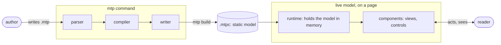
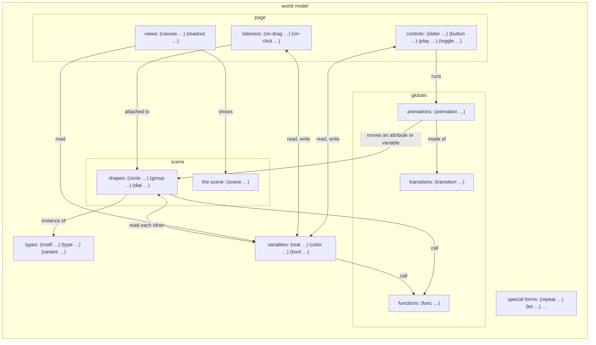
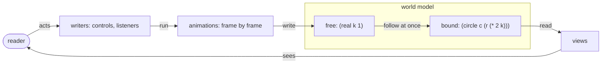

# The data model

Who is involved, how a source file becomes something a reader can use, and what the world model holds.

## Four actors and the static model

Two actors sit on each side of one file. On the left, the **author** writes a source file and the **mtp command** compiles it. On the right, the **live model** is what that file becomes, and the **reader** uses it. In the middle is the **.mtpc**, the static model: the only thing that passes from one side to the other.

### The author

Writes a mathematical figure as a `.mtp` source file: the shapes, the values they depend on, how they can move, and how a reader can act on them. The author thinks about mathematics and how to show it, not about programming, so the language says what things are and leaves keeping them current to the software. The author then places pieces of the result on a web page (a drawing here, a slider there, a number inside a sentence) and styles them with the page's own CSS.

### The mtp command

Runs on the author's machine. The **parser** reads the text into forms and knows only the syntax. The **compiler** resolves every name, checks every type, works out everything that can be known in advance, and builds the model. The **writer** saves it as the .mtpc. Compiling should be fast, but the reader comes first: anything that can be decided here is, even when it makes compiling slower.

### The live model

What the .mtpc becomes on a page. The **runtime**, a library the page loads, rebuilds the model in memory, keeps it current as the reader acts, and serves the **components** the author placed on the page.

### The reader

Opens the page and uses what the author placed there: drags points, moves sliders, presses play, reads values in the prose. The reader never sees the language, and expects every action to show its effect at once. That is the first requirement of everything here: nothing is decided while the reader waits.

**The .mtpc** (mtp compiled) is a JSON file: the model's static representation. Objects have ids, expressions are Lisp-shaped arrays with the operation first, every reference to an object is resolved to an id, and every type the runtime needs is written down. The runtime never reads the source. Its format is specified in `mtpc.md`.

## The language

An `.mtp` file is written in the mtp language. It is Lisp-like: everything is a form in parentheses, with the head first, as in `(circle p (r 0.2))`. It is declarative: the author says what exists and what each thing is equal to, never what to do step by step, and it is reactive: anything given by an expression is bound to it, and follows it for as long as the page is open. When the reader moves a slider, everything that reads what the slider writes changes at once, with nothing written to make that happen. It is strongly and statically typed: every object's type is known when compiling, and nothing converts silently except a number broadening (an int where a real is expected) and a literal taking the type of its place. Names are bare. Nothing has a side effect except a declaration making its object exist.

Everything in a source file is an **expression**. Some expressions are **forms**: a head and its parts in parentheses. Some forms are **declarations**: their only effect is that a new object exists in the world model, and they return that object, as `(circle p (r 0.2))` returns the circle it declares. Components (views, controls and listeners) are declarations too. **Function calls** have no effect at all and matter only for what they return, as `(+ k 1)` does. A few **special forms** are exceptions, each documented on its own: `if`, `cond`, `and` and `or` evaluate only what they need; `let` and `fn` bind names; `repeat` stands for the expressions it produces, spliced in place when compiling; `(. X Y)` does not evaluate `Y` when it is an attribute name; `(name s)` turns a string into a name. Type expressions, such as `list[color]` or `(real (>= 0))`, are not evaluated at all: they describe a type.

The whole purpose of an `.mtp` file is to define one **world model** (the **model** for short), as a sequence of declarations.

## The world model

The world model is everything one source file defines. The compiler builds it, the .mtpc stores it, and the runtime holds it live. **Everything in the model is an object, and every object has a type.**

Objects are of two sorts. A **value** is an immutable object: it never changes, and an expression that gives one gives just that value. The number 3 is a value. A **mutable object** can change over time: an attribute of it is written by the reader's actions, or follows an expression that reads something that changed.

A **variable**, such as `(real k 1)`, is not a value: it is a name for a piece of state that holds one object of its type at a time. The objects it holds may be values (3, then 4) or mutable objects (a shape). It evaluates to what it currently holds, and has no attributes of its own.

Every box below has a title and examples of the forms that declare what it holds. Arrows are relations between them. Apart from function calls, forms fall into five groups: special forms, declarations that create types, declarations of things in the scene, declarations of things on the page, and **globals**: declarations of things in neither, which both use. A variable belongs to the scene when declared in it, and to the globals otherwise. Either way, views may read it, and controls and listeners may read it and write it, as long as it is free, has no `const` constraint, and is not a token. A motif's body may declare only bound variables; free per-instance state is a motif parameter.

Variables are declared inside the scene (then they belong to it), at the top level (then they are globals), or in a motif's body (then each instance holds them; only bound ones). They are not declared inside groups. The diagram draws them once.

- **The scene** is the mathematical content: the shapes, and the variables declared with them. It is a subset of the model and knows nothing of how it is shown or changed. The model includes the scene; the scene never includes the rest of the model.
- **Components** are what the author places or attaches on the page. They come in two sorts, by the direction information flows: **writers** (controls and listeners) carry the reader's actions into the model; **views** carry the model to the reader. ("Reader" on its own always means the person.) Basic components come from the standard library, and authors will be able to make their own from them.
- **Other ways of showing the model** are possible later: scripts on the page reading the model (the page may read it; whether it may write is open), descriptions for screen readers, sound, and export to an image or data.

## What changes, and what follows

Every variable, and every attribute of a mutable object, is either **free** or **bound**.

- **Free**: it holds whatever was last written to it, starting with the object its declaration gives (a literal, or a default). While the reader uses the page, only writers (controls and listeners) and the animations they run may write it. Free places include a variable given a value, a shape attribute given a value, a motif parameter of an instance, and an attribute a variant leaves unset. A write to a group's attribute (`g.r`) writes each member's.
- **Bound**: it is given by an expression, and always equals that expression. Nothing may write it.

&nbsp;

    (real k 1)                     ; free: a slider may write it
    (circle c (r (* 2 k)))         ; c.r is bound: it is always twice k
    (slider s (animation (k (transition (to 3)))))

So every change starts at something free, and spreads to everything bound to it: when the slider writes `k`, `c.r` follows at once, and so does anything that reads `c.r`. The runtime recomputes only what reads what changed. A free variable with the `const` constraint can never be written, so it is known when compiling and costs nothing while drawing.

## How reactivity works

A world model is not a program that runs from top to bottom. It is a set of statements that are true at every moment: `(circle c (r (* 2 k)))` does not set `c.r` once, it says that `c.r` is always twice `k`.

- **Change only enters through writers.** When the reader acts, a control or a listener runs an animation, and the animation writes free places over time, frame by frame. A drag writes its target directly, and so does a toggle.
- **Bound places follow at once.** The compiler knows what every expression reads, so after a write the runtime recomputes only what depends on it, and the views redraw. Nothing has to be told to update.
- **Writes respect types.** A write that breaks a constraint is brought into it (clamped, rounded or held). This is the one place a real becomes an int without being asked: a write into an int is rounded. A `const` variable is never written at all.

### Why there is no assignment

In a programming language, `k = 3` is an instruction: at this step, change `k`. Its effect depends on when it runs and what ran before. mtp has no steps. If an expression could assign, `c.r = 2k` could be true before it and false after it, and the drawing would depend on the order the runtime happened to evaluate things in. Instead, the only writes are the reader's actions, carried by writers, and they reach only free values. Every bound relation the author wrote holds in every frame the reader sees.

## On the page

The author connects a world model to a web page with HTML elements.

    <mtp-model id="dial" src="dial.mtpc"></mtp-model>

    
Drag the slider <mtp-slider model="dial" name="s"></mtp-slider>
       and watch the radius, now <mtp-readout model="dial" name="r"></mtp-readout>.

    <mtp-canvas model="dial" name="v"></mtp-canvas>

- **`<mtp-model>`** loads one .mtpc, once, and gives the live model an id.
- **Each component is an element** placed anywhere on the page, naming its model and the view or control it presents: `<mtp-canvas>`, `<mtp-readout>`, `<mtp-slider>`, `<mtp-button>`, `<mtp-play>`, `<mtp-toggle>`. Listeners have no element: they act through the canvas that draws their shape.
- **One live model feeds any number of components,** which share its state: the slider in one paragraph, the readout inside a sentence and the canvas below all change together.
- **A page may load several world models.** Each has its own state; components of one never affect another.
- **The page styles components with its own CSS.** Tokens, the color and font variables, appear as CSS custom properties (such as `--mtp-ink`) that the page may override.
- **The page may read a live model.** Whether it may also write to one is open.

## Two properties of every expression

- **Binding time** (or just time): whether what an expression gives is known when compiling, and then folded into the .mtpc as a plain value, or only while the reader uses the page. A bound variable or attribute takes the time of its expression. `rand` counts as known only while the reader uses the page, though its number is drawn once, when the page loads.
- **Access**: who may read an expression. It takes the access of what it reads: an expression that reads only the scene (or nothing, like a literal or a function of its arguments) has scene access and may be read by anything; one that reads a component has page access and may be read only by components and by globals (variables, functions, transitions and animations declared outside the scene). The scene may never read anything with page access. Globals take the access of what they read; being written by a slider does not give a variable page access, reading one does.

## Open

- Whether a page may write to a model, not only read it.
- Vectors, and passing types as values (see the type system document, "Not yet").
